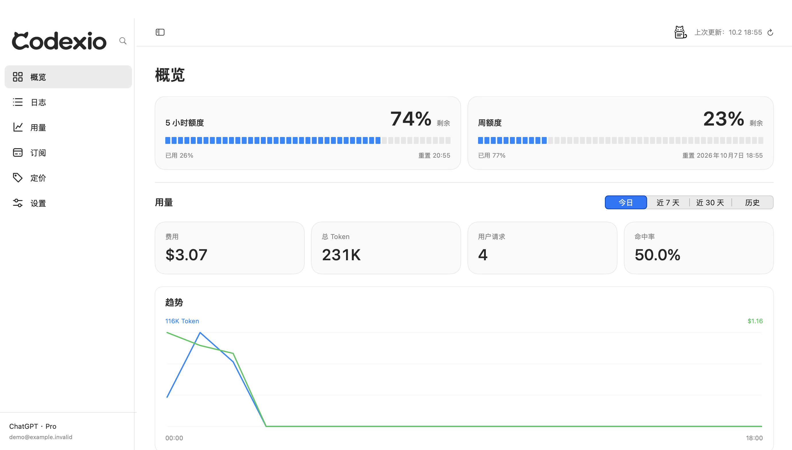

  

<h1 align="center">Codexio</h1>

查看 ChatGPT／Codex、Claude Code 与 Antigravity App 的额度、用量和请求。

  <a href="https://github.com/Wujuhu/Codexio/releases/latest/download/Codexio.app.zip"><strong>下载 macOS 版</strong></a> ·
  <a href="https://github.com/Wujuhu/Codexio/releases/latest/download/Codexio.exe"><strong>下载 Windows 版</strong></a> ·
  <a href="https://github.com/Wujuhu/Codexio/releases">所有版本</a> ·
  <a href="https://github.com/Wujuhu/Codexio/issues">反馈问题</a>

Codexio 是 Codex、Claude Code 与 Antigravity App 的用量和请求看板。它读取本机日志，汇总 Token、费用估算、请求记录和使用趋势，结合账户额度帮助你了解日常使用情况。Mac 提供菜单栏与桌面小组件，Windows 提供系统托盘。

macOS 主分支开发界面，使用隔离模拟数据；正式安装包的界面可能有所不同。

## 下载与安装

当前 Mac 与 Windows 源码版本为 **0.3.19**。正式安装包、各平台版本与更新说明以 **[最新 Release](https://github.com/Wujuhu/Codexio/releases/latest)** 和其中的 `latest.json` 为准。

| 平台 | 系统要求 | 安装包 |
| --- | --- | --- |
| macOS | macOS 15+ · Apple Silicon（arm64） | [Codexio.app.zip](https://github.com/Wujuhu/Codexio/releases/latest/download/Codexio.app.zip) |
| Windows | Windows 10/11 x64 · WebView2 Runtime | [Codexio.exe](https://github.com/Wujuhu/Codexio/releases/latest/download/Codexio.exe) |

后续正式发布提供 Mac ZIP、Windows EXE 和共享清单三个附件。iOS App 与手机同步已退役，历史正式版及其附件保留。开发源码包含尚未发布的改动，正式包以对应 Release 更新说明为准。

### macOS

1. 下载并解压 ZIP，将 `Codexio.app` 放入“应用程序”后打开。
2. 在这台 Mac 上登录并使用 Codex。Codexio 会尝试发现可用的 Codex 组件，并读取本机日志。
3. 使用自定义安装或日志目录时，在 **设置 → 数据** 配置组件路径与日志目录；默认日志根目录为 `~/.codex`。
4. 在 **设置 → 菜单栏** 选择显示字段和顺序；桌面小组件可从 macOS 小组件库添加。

Mac 使用 `/Applications/Codexio.app` 作为稳定安装位置。从其他目录打开完整 App 时，会校验并接管该位置后重新启动，以保持唯一的小组件扩展。应用内更新在下载完成后由你主动选择安装。

### Windows

1. 下载 `Codexio.exe`，确认系统已安装 WebView2 Runtime，然后运行。
2. 登录并使用本机 Codex；如目录未自动识别，在设置中配置数据路径。
3. 关闭主窗口后，可从系统托盘重新打开。退出应用使用托盘菜单。

网络请求和额度查询组件使用 Windows 当前配置的手动系统代理，未配置时回退到环境变量；应用不固定代理地址或端口。运行期间变更代理后，重新打开 Codexio 可让额度查询组件立即采用新设置。

## 功能概览

| 功能 | 内容 |
| --- | --- |
| **客户端切换** | Mac／Windows 概览、日志、用量与订阅可在 ChatGPT／Codex、本地 Claude Code 和 Antigravity App 间切换。首次启动默认 ChatGPT／Codex，此后恢复主窗口上次选择的客户端。定价目录独立 |
| **额度与任务** | 5 小时／周剩余额度、重置时间、当前任务与最近请求 |
| **请求记录** | 按日期、模型和状态筛选，查看请求时选择的模型名称、Token、费用、思考强度、速度、任务实时耗时、可靠来源的 TPS／TTFT 与可用正文 |
| **用量分析** | 费用、总 Token、用户请求、命中率，以及趋势、活动热图、模型构成；聊天排行按本地线程费用或 Token 排序 |
| **执行行程** | 按项目、线程和用户请求查看模型调用、工具与命令、文件操作、子代理和中断／继续事件，支持返回 Codex 对话 |
| **AI 使用报告** | 日报、周报与月报，回顾用量和模型偏好，并导出报告图片 |
| **订阅与定价** | 订阅周期统计；GPT／Claude／其他三组官方基础价、精简倍率浮窗及明确模型别名匹配 |
| **桌面集成** | Mac 菜单栏字段选择与排序、请求／额度小组件。Windows 通过系统托盘查看额度并唤起主窗口 |

执行行程位于 Mac／Windows 的 **用量 → 活动** 底部。两栏分别显示执行过程与资源详情：按整个线程、当前用户请求和选中步骤查看费用、Token、模型调用、耗时及可用配置。已有项目保留归属，其余对话统一归入“聊天”。命令通过工具名旁的按钮打开，支持自动换行与复制；模型调用和用户引导使用不同的淡色区分。

过程来自本机可读取的 Codex／Claude Code 记录，按需分页加载。单个工具通常没有独立的 Token 或费用数据，应用不会分摊模型调用的消耗；日志缺失的摘要、计时等字段显示 `—`，不重建不可见的思考过程。文件操作展示路径和类型，不展开文件差异或完整命令输出。此执行行程仅在桌面端展示。

Antigravity 读取原版桌面 App 的本地会话记录，提供概览、日志、用量、正文详情和使用报告。额度来自已登录 App 自带的本机语言服务，兼容 Antigravity 2.34，显示主 Gemini 额度池的 5 小时和周剩余量及重置时间。App 运行时可刷新，订阅页在积累有效采样后显示周额度估算，未获取的数据和已过重置时间的额度显示 `—`。Mac 菜单栏弹层纵向排列三组 Agent 卡片，菜单栏设置可选 Antigravity 字段。小组件和 Windows 托盘也使用本机额度数据。[Antigravity 日志来源](https://antigravity.google/docs/hooks#common-input-fields)

当前桌面源码同时读取 Codex 的 `.jsonl` 与 `.jsonl.zst` 压缩会话日志，包含归档会话；历史 Token、费用、请求分组、可读取的正文与执行行程沿用同一解析和计价规则。文件压缩后仍使用原有记录身份，避免重复计数，来源暂时不可见也不会清除已经确认的用量。已采集的完整请求正文与元数据压缩后长期保存，内嵌图片按内容哈希保留；清理明文缓存不删除这些正式历史数据。解压在后台进行，临时文件在最后一个读取者关闭时删除；来源未变化且已经完成采集和归档时，不重复解压。不以 1 GB 文件或前 64 MB 正文范围作为读取截止条件，原始 Codex 文件保持只读。

Windows 启动时先显示已保存的统计，历史回补和服务初始化在后台继续，界面只读查询与写入分开。用量页按所选标签读取活动、详情与排行，汇总复用已保存的逐调用计量结果；Claude 请求汇总使用请求索引，避免逐条请求重复扫描整个账本；切换页面会取消旧读取，超时后可重试。Mac 活动统计也按需读取，详情和排行继续分页。两端额度查询遇到暂时超时会复用可用后端并延后重试，减少反复初始化带来的后台请求。

定价目录支持 GPT‑6.1 Terra，并按已确认的 Sol 分模式口径提供 Ultra Fast 参考计价；Gemini 4 Argon 支持明确型号匹配和 Standard 参考价。第三方服务的实际收费可能不同。模型调用耗时与首 Token 时间只读取能够准确关联到该调用的本地字段；完成且耗时、输出有效时计算平均 TPS，缺失保持 `—`。计时不依赖上游检测，也不启用额外遥测。具体交付范围以对应 Release 说明为准。

Claude Code 入口合并本机终端与 Desktop 的 Code 会话，默认读取 `~/.claude/projects`（Windows 为 `%USERPROFILE%\.claude\projects`），启动时也可读取 Codexio 自身环境中的 `CLAUDE_CONFIG_DIR`；本轮不处理目录迁移。第三方 API 返回的 GPT／Gemini 等模型仍归 Claude 客户端来源；Token 按真实回复去重，完整输入包括缓存读取和缓存写入，推理 Token 不再次加进输出。Claude 订阅页显示套餐／邮箱、5 小时和周额度、周额度估算，不提供套餐历史或主动重置。额度由 Claude Code 的官方 Mods 被动提供，旧 CLI 兼容 statusLine；不发模型请求、不直接请求 OAuth 额度接口。主 App 运行时默认安装本地桥接，保留已有配置与 statusLine 输出，已有会话在下一次加载插件后生效。CLI Mods 需 2.1.287+，Desktop 本地 Code 引擎需 2.1.286+，无需单独安装 CLI；未支持 Mods 的 Desktop、WSL 和未提供额度的数据源显示 `—`。公开数据不能确认账号时，邮箱／套餐保留 `—`；Desktop-only 有效额度仍可按本机来源和周周期生成估算，不要求额外账号接口查询。Codex／Claude 周估算默认使用 10 分钟完整窗口，也可选 30／60 分钟；采样中断的窗口作废，无消费或额度比例未变化时跳过，不跨窗口累计。已保存请求时显示名称的记录，优先用该名称匹配计价型号；名称无法唯一匹配价格目录时显示 `—`，不改套其他返回型号的价格。缺少显示名称证据的历史记录保留原有返回型号计价口径，不用当前配置回填；价格采用对应型号已确认的官方 Standard 参考价及适用规则；GPT、Claude、Gemini、DeepSeek、GLM、Kimi 共用型号匹配，缓存读取与缓存写入分开计算；Claude 官方模型继续区分 5 分钟与 1 小时写入，“其他”组统一使用 5 分钟写入参考价；Fast 按当前受支持型号规则处理，无法确定的费用保留 `—` 或标为估算。速度仅使用原始记录，缺失显示 `—`。活动热图补齐最近 365 天；两种客户端的日志筛选、字段及列宽分别保存，默认隐藏命中率；请求副行显示上下文窗口容量，缺失为 `—`。Claude 用量活动页提供相同布局的执行行程，按项目／线程／请求分页读取明确归属的模型调用、工具和子代理过程；缺失正文或计时保留 `—`，不分摊工具费用或 Token。任务进行中以主请求的原始开始时间实时计时，进度更新和切页不重置起点，工具执行阶段继续走秒。完成后优先采用明确轮次计时，缺少时使用最后一次主调用以 `end_turn`／`stop_sequence` 结束整轮的时间减请求开始时间，排除子代理结束时间；缺少可靠起点或运行依据失效时显示 `—`，不把整轮耗时分配给逐次模型调用。TPS 仅在请求完成且输出和正耗时有效时计算，TTFT 仍只采用原始首 Token 计时。普通 Chat、Cowork、未落盘的 side chat 和仅存在远端的会话不在本轮范围。

v0.3.10 的小猫报告支持在 ChatGPT／Claude 之间切换日报、周报和月报，使用各自的本地账本及计价结果。Mac 菜单栏可分别选择双方的任务、额度和用量字段，小组件为双方各提供六种展示。Claude 原始日志被清理或删除后，已经采集的统计和请求摘要保留，已删除正文／附件显示缺失。详细范围见 [Claude 适配规格](docs/superpowers/specs/2026-10-13-claude-code-desktop-design.md)。v0.3.10 的订阅、定价及版本比较范围见 [实现规格](docs/superpowers/specs/2026-10-16-claude-subscription-v0310-beta.md)。正式安装包以 Release 说明为准。

Mac／Windows 日志与概览最近请求优先显示请求时选择的 display name，费用也使用同一份名称快照匹配价格目录；原始请求 ID 与返回模型保留在详情中。费用单元格的悬浮提示显示实际计价模型 ID，多个模型逐行列出。自定义模型名称在新版 Codexio 记录配置后发出的新请求中生效，原聊天可继续使用；已有名称快照不会被后续改名覆盖。历史仅在有可靠的请求时名称依据时补齐，缺少依据的记录不以当前配置猜测改写。

v0.3.16 优化桌面启动和后台刷新。Mac 首屏读取轻量概览快照，Windows 先显示已提交的统计，再在后台采集和更新。少量记录变化时，仅更新受影响的请求、排行和时间分桶，复杂归属或依赖变化时回退全量。使用报告会等待所选客户端的首轮数据准备完成，避免首次打开时生成空报告。Windows 关闭主窗口后通过系统托盘继续使用。

v0.3.17 缩短 Windows 首次导入时打开概览后等待统计的路径。空账本有当天 Codex 记录时，Codex 扫描完成后可先看到统计，Claude Code 历史继续在后台导入。Windows 日志也会按 Claude 会话实际生效的模型选择器配置保存显示名称。

定价目录支持 GPT‑6.2 Astra、GPT‑6.2 Sol、Claude Fable 5.2 和“其他”组的 Gemini 4 Carbon、Neon、Argon、Hydrogen。两款 GPT‑6.2 按订阅、credits 与 API Key 分别计算速度和长上下文倍率，Ultra Fast 的优惠与后续费率按调用时间选用。Claude 按版本号降序，同版本按标准输出单价降序排列。Carbon 与 Argon 的优惠在 2026-11-30 后结束，历史调用按发生时的价格统计。具体费率和日期边界见 [计价规则](docs/codex-pricing.md)。

## 数据与隐私

**费用是按模型价格与应用规则折算的 API 等价值，不是实际账单、ChatGPT 订阅扣款或官方 Credits。** 基础价、认证／消费来源与 Fast／Ultrafast／长上下文规则分别计算；第三方服务的实际计费可能不同，缺少价格时显示 `—`，部分定价状态单独标记。总 Token 为输入与输出之和，缓存与推理 Token 不重复累加；用户请求数与模型调用数分别统计。Mac／Windows 汇总跳过各项指标缺失的数据，保留可计算部分；数据不完整提醒关闭后，本次运行期间不再显示，完全退出再启动后才恢复提示。详见 [计价规则](docs/codex-pricing.md) 与 [数据口径](docs/v0.3.1/DATA_CAPABILITIES.md)。

Codexio 只读采集原始 Codex、Claude Code 与 Antigravity App 日志，设置、账本、请求正文和图片缓存保存在本机。iOS App、局域网配对及云同步已退役，历史正式版可从对应 Release 查阅。

可选的 **上游检测** 默认关闭。开启后，相关请求经本机转发以关联响应 ID 和模型名称；关闭或正常退出时恢复原服务配置。使用前可阅读 [上游检测说明](docs/upstream-detection.md)。

## 常见问题

**为什么账户额度与本机用量不同，或者额度不可用？**

账户额度可能由多台设备共同消耗，本机统计只来自当前电脑可读取的日志。额度卡对应当前登录账号；费用、Token、用户请求及命中率按已采集日志和所选时间范围汇总，不按当前登录账号隔离。若同一电脑保存了多个账号的日志，会一起累计；切换登录账号不会改变历史归属或清空统计。ChatGPT 登录模式可查询订阅额度；API Key 或自定义 provider 模式保留本机用量统计，官方订阅额度显示为不适用。缺少的请求信息显示 `—`，连接或同步错误保留具体提示。

**关闭 Mac 窗口后还会继续运行吗？**

会，主 App 可继续在菜单栏运行。⌘Q 会退出主 App，停止采集、额度查询和上游转发；小组件会提示“打开 Codexio 主程序”。小组件不独立采集，也不会自行启动主 App。

## 开发与贡献

Mac 使用 Swift／SwiftUI／AppKit／WidgetKit，Windows 使用 Wails + Go 与 Svelte／TypeScript。旧 Python 桌面程序已退役；Python 仅保留原生 Mac 启动、构建／交付工具和必要的规则参考，共享图标、价格种子与翻译资源继续保留。详见 [Python 目录说明](src/codexio/README.md)，完整旧版可从 [v0.2.10 源码](https://github.com/Wujuhu/Codexio/tree/v0.2.10/src/codexio)及 Git 历史查阅。

| 平台 | 构建环境 | 开发打包入口 |
| --- | --- | --- |
| macOS | 完整 Xcode（macOS 26+ SDK）、Python 3.12／3.13 | `./build_macos.sh` |
| Windows | Windows x64、Go 1.26.1、Node.js/npm；脚本固定 Wails 版本 | `.\build_exe.ps1` |

Mac 入口自动创建或复用 `.venv`；Python 仅参与构建与交付，原生 App 运行不依赖 Python。开发产物位于 `build/dev/<平台>`，打包不会自动推送或发布。修改前请阅读 [AGENTS.md](AGENTS.md)，遵守平台范围、最小冒烟与交付约定。日常桌面功能与适用修复默认同时覆盖 Mac 和 Windows；源码在本机修改，Windows 通过 SSH 在本地 Windows 主机构建。收到明确的推送并发布指令后，由发布协调脚本统一核验 Mac／Windows 产物、推送、发布及归档；未指定版本时使用仓库现有最新源码版本，不自行递增版本号，无需二次确认。云端构建需要单独授权。

欢迎通过 [Issues](https://github.com/Wujuhu/Codexio/issues) 反馈问题、建议功能或提交文档修正。问题报告请包含应用版本、系统版本与复现步骤，并移除个人请求内容和凭据。

## 文档

- [macOS 开发说明](docs/macos.md) · [Windows Wails 开发说明](docs/v0.3.4/WINDOWS_WAILS.md)
- [计价规则](docs/codex-pricing.md) · [上游检测](docs/upstream-detection.md)
- [当前开发记录](docs/v0.3.5/DEVELOPMENT.md) · [协作与交付约定](AGENTS.md)

开发记录包含历史过程，具体行为请以对应版本的源码与安装包为准。
